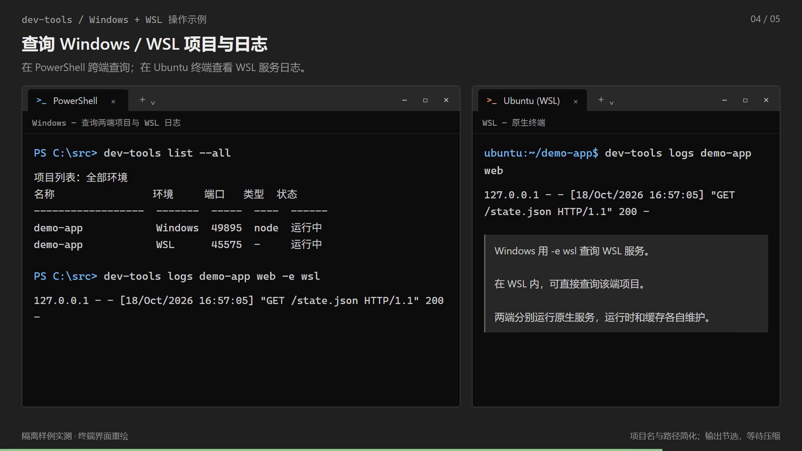

# dev-tools

[简体中文](README.md) · **English**

[](LICENSE) [](docs/installation.en.md) [](docs/installation.en.md) [](docs/installation.en.md) [](CHANGELOG.md)

Hot deployment and live updates for development projects on Windows and WSL.

Prepare runtimes and dependencies and start services from project declarations. Follow source, dependency and configuration changes to build or restore affected services.

## Demo

[](docs/assets/dev-tools-demo.zh.mp4)

[Watch the 42-second walkthrough](docs/assets/dev-tools-demo.zh.mp4) (Chinese): start a project → edit source → update dependencies → read logs across environments → inspect a port.

Based on an isolated sample running the actual tool, with redrawn terminal interfaces, excerpted output and shortened waits. The sample uses a declared build task and a Python HTTP service; reload behavior depends on project configuration and the framework.

## Installation

### Scoop

Run in Windows PowerShell:

```powershell
scoop bucket add hxd-box https://github.com/hhhxxxddd/hxd-box
scoop install hxd-box/dev-tools
```

Installs the official release and prepares Git, PowerShell 7, mise and the Python 3.14 controller host.

### Git

Prepare the dependencies listed below, then run in PowerShell 7:

```powershell
git clone https://github.com/hhhxxxddd/dev-tools.git
cd dev-tools
.\scripts\install.ps1
```

Reopen the terminal after installation. See the [installation guide](docs/installation.en.md) for existing Python bindings and native WSL installation.

To manage WSL projects, deploy from Windows to a WSL distribution with systemd enabled:

```powershell
dev-tools self update -e wsl
```

Ubuntu is the default distribution; change it in local preferences.

## Getting started

Run in the root of the project you want to manage:

```powershell
dev-tools init
dev-tools register
dev-tools start
```

`init` generates missing project configuration and preserves existing files. `register` creates a local binding. `start` prepares the environment and starts services and monitoring.

Source changes trigger declared reloads or builds. Dependency, lockfile and configuration changes trigger preparation and service recovery. Some changes briefly stop services; project declarations determine the behavior.

Omit `-e` for the current platform. Use `-e win` / `-e wsl` from either platform to select the target, for example:

```powershell
dev-tools register -e wsl
dev-tools start -e wsl
dev-tools list --all
```

Registration and lifecycle operations in a native WSL terminal require `sudo`. If an entrypoint cannot be determined automatically, complete the project configuration before starting.

## Supported projects

| Project type | Default detection and configuration generation |
| --- | --- |
| Node.js / frontend | npm, pnpm, Yarn and Bun; detects Next.js, Vite and React, generating dependency preparation and dev/start services |
| Python | Reads pyproject.toml and generates uv or pip preparation; FastAPI projects can receive a Uvicorn reload service |
| Java / Maven | Detects multiple modules, Maven Wrapper and Spring Boot, generating preparation and hot deployment workflows |
| Docker Compose | Uses existing Compose declarations; automatic discovery prefers Compose |
| Rust / Tauri, Gradle, custom processes | Supports version metadata scanning; configure tasks and startup commands explicitly |

Supports mixed-language projects and declared workspaces and modules. See [project configuration](docs/project-config.en.md) and [examples](examples/README.md) for fields and templates.

## Common operations

| Command | Purpose |
| --- | --- |
| `dev-tools list --all` | List projects, ports and status in Windows and WSL |
| `dev-tools check my-app` | Inspect the preparation plan and blockers read-only |
| `dev-tools status my-app -e wsl` | Inspect WSL project services and health |
| `dev-tools logs my-app api -e wsl --follow` | Follow the api service log of the selected project |
| `dev-tools stop my-app` | Stop services and automatic maintenance |
| `dev-tools unregister my-app` | Stop and unregister; keep source, caches and runtimes by default |
| `dev-tools upgrade` | Obtain an update; stop and restore affected projects after confirmation |
| `dev-tools -v` / `dev-tools help` | Show the version or help |

Omit the project name in a directory that uniquely matches a registered project. `logs my-app` combines project logs, `logs my-app api` selects a service, and `logs my-app --task` reads task logs.

### Toolbox

| Command | Purpose |
| --- | --- |
| `dev-tools ports show 3000` | Locate listening ports, processes and verifiable project ownership |
| `dev-tools which python -e wsl` | Inspect WSL PATH candidates and link targets |
| `dev-tools net check http://localhost:3000/health` | Diagnose DNS, TCP, TLS and HTTP connections |
| `dev-tools ssh list --edit` | Edit the SSH list interactively |
| `dev-tools hosts list --edit -e win` | Edit Windows hosts interactively |

SSH, port, PATH and network tools support Windows and WSL; hosts manages Windows only. Running a toolbox command alone displays help. Text editor commands `ssh edit` and `hosts edit` remain available.

## Execution and configuration

Windows uses the source directory directly. WSL synchronizes source into a native Linux workspace, keeping dependencies, builds and services in Linux. Both environments share project declarations and maintain their own runtimes, dependencies, caches and local registrations.

| Configuration | Contents |
| --- | --- |
| Project-root `dev-tools.toml` | Tasks, services, health checks, build and synchronization policies |
| Project-root `mise.toml` / `.mise.toml` | Project runtime versions |
| Each platform's user `config.toml` | dev-tools language, editor, WSL distribution, system information and report preferences |

```powershell
dev-tools config edit
dev-tools config check
```

Chinese is the default. Set `language = "en"` in local preferences for English. Editors are selected from the configured command, VISUAL, EDITOR, then Windows Notepad / WSL vi.

Scanning does not read `.gitignore`; workflows, workspaces and `[scan]` settings determine scope. `scan` and `check` are read-only. Runtime installation uses only project-root mise declarations. Middleware comes from the project's own Compose configuration or an external environment.

## Requirements

| Platform / dependency | Requirement |
| --- | --- |
| Windows | Windows 11 and PowerShell 7 or newer |
| WSL (optional) | WSL 2, verified on Ubuntu 24.04 LTS; systemd enabled and rsync available |
| Python | `>=3.14.8,<3.15`; standard-library-only controller, with support for existing native interpreters |
| Git / mise | Git for source installation and updates; mise for default host installation and project runtimes |
| Docker (optional) | Docker and Compose v2 for Compose projects |

Project Node.js, Java and other versions follow project-root mise configuration, separately from the controller host.

## Documentation

[Installation and updates](docs/installation.en.md) · [Project configuration](docs/project-config.en.md) · [Operation](docs/usage.en.md) · [Examples](examples/README.md)

[CLI and automation contract](docs/cli-contract.en.md) · [Development and contributing](docs/development.en.md) · [Changelog](CHANGELOG.md) · [MIT license](LICENSE)
